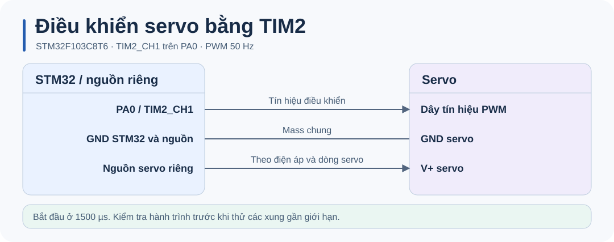
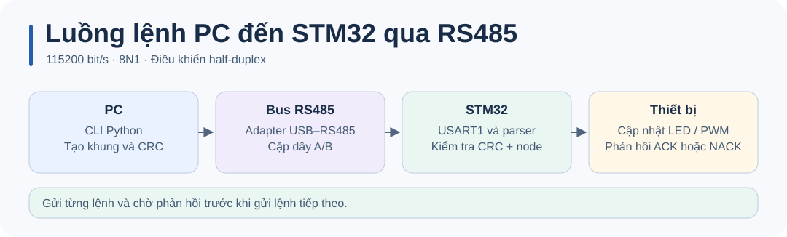

# STM32 Timer · Servo PWM và điều khiển RS485

Demo **TIM2 PWM trên STM32F103C8T6**. Servo khởi động ở xung trung tâm 1500 µs; có thể gửi lệnh RS485 từ PC để thay đổi độ rộng xung, điều khiển LED PC13 và đọc trạng thái.



## Phần cứng và cấu hình

| Tín hiệu | Chân | Cấu hình |
| --- | --- | --- |
| PWM servo | PA0 | TIM2_CH1, 50 Hz, xung khởi động 1500 µs |
| UART RS485 | PA9 / PA10 | USART1 TX/RX, 115200 8N1 |
| Điều khiển hướng RS485 | PA8 | DE và /RE, mức thấp ở chế độ nhận |
| LED | PC13 | Active-low |

Cấp nguồn riêng cho servo theo thông số của thiết bị và nối GND nguồn servo với GND Blue Pill. Lúc thử lần đầu, để servo ở trạng thái không tải và bắt đầu với xung gần 1500 µs. [Hướng dẫn đấu RS485](docs/RS485_HARDWARE_SETUP.md)

TIM2 nhận xung 72 MHz. Prescaler `71` tạo tick 1 µs và ARR `19999` tạo chu kỳ 20 ms. Giá trị CCR1 tính bằng µs. Khoảng 500–2500 µs là giới hạn phần mềm, hành trình thực tế tùy servo.

## Build và nạp firmware

Cần **Python 3.9+**, **GNU Arm Embedded** (`arm-none-eabi-gcc`, `objcopy`, `size`) và gói **STM32CubeF1 v1.8.7**. Script dùng HAL và startup từ gói ST, cùng linker script 64 KiB flash / 20 KiB SRAM của STM32F103C8.

```sh
python build.py
```

Đặt GNU Arm Embedded vào `PATH`, hoặc chỉ định thư mục `bin` của toolchain. Nếu gói HAL nằm ngoài thư mục mặc định `~/STM32Cube/Repository/STM32Cube_FW_F1_V1.8.7`, truyền đường dẫn tới thư mục chứa `Drivers`.

```sh
python build.py --sdk "<STM32CubeF1 root>" --toolchain "<GNU Arm bin>"
```

Build tạo `build/firmware.elf`, `build/firmware.hex` và `build/firmware.bin`. Nạp `.hex` bằng STM32CubeProgrammer qua ST-LINK/SWD, rồi reset board. Có thể dùng `.elf` để nạp symbol và debug. Firmware mẫu dùng HSE 8 MHz và SYSCLK 72 MHz.

Tài liệu công cụ: [STM32CubeF1](https://github.com/STMicroelectronics/STM32CubeF1) · [STM32CubeProgrammer](https://www.st.com/en/development-tools/stm32cubeprog.html).

## Chạy thử

1. Đấu servo, nạp firmware rồi kiểm tra PWM tại PA0. Khi reset, servo nhận xung 1500 µs.
2. Đấu USB–RS485 và transceiver 3,3 V theo [sơ đồ](docs/RS485_HARDWARE_SETUP.md). Node mặc định là `1`.
3. Cài `pyserial` để gửi lệnh thật. Thay `COM5` bằng tên cổng đang dùng.

```sh
python tools/rs485_cli.py ping --dry-run
python -m pip install pyserial
python tools/rs485_cli.py ping --port COM5
python tools/rs485_cli.py pulse --pulse 1600 --port COM5
python tools/rs485_cli.py status --port COM5
```



## Tài liệu và mã nguồn

- [Luồng chương trình](docs/CODE_GUIDE.md) và [hướng dẫn firmware](docs/RS485_STM32_GUIDE.md).
- [Định dạng khung, CRC và bảng lệnh](docs/RS485_PROTOCOL_UART_DETAIL.md).
- [Dùng CLI Python](docs/RS485_PYTHON_GUIDE.md).
- [Cấu hình CubeMX tham khảo](Digital_Servo.ioc) cho PWM và USART1. Build CLI dùng cấu hình chân trong mã nguồn.
