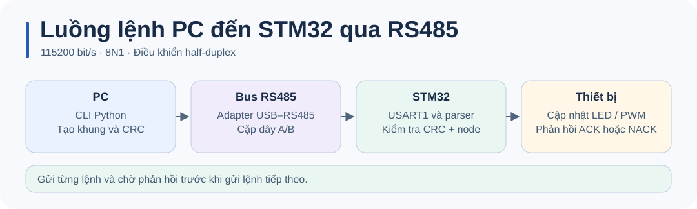

# STM32 Timer · Hướng dẫn kỹ thuật

Xem [README](../README.md) để đấu dây, build và chạy thử.

## Cấu hình

TIM2_CH1 trên PA0 tạo PWM 50 Hz, USART1 trên PA9/PA10 chạy 115200 8N1. Xem [thiết lập firmware](RS485_STM32_GUIDE.md) và [CubeMX](../config/Digital_Servo.ioc).

## Luồng hoạt động

1. [`main.c`](../Core/Src/main.c) cấu hình xung, GPIO, TIM2 PWM và USART1. TIM2 bắt đầu với xung 1500 µs.
2. [Board support](../firmware/board.c) cấu hình PA0 PWM, PA9/PA10 USART1 và IRQ. [Driver RS485](../Core/Src/rs485_uart.c) đặt PA8 ở chế độ nhận và đưa các byte từ callback vào parser.
3. [Parser](../Core/Src/rs485_protocol.c) kiểm CRC và xuất một khung hoàn chỉnh. Driver giữ một khung hợp lệ cho vòng lặp chính.
4. `main()` thực thi lệnh và trả ACK/NACK qua cùng bus. Trình gửi chờ phản hồi trước khi gửi lệnh kế tiếp.

Xem [thiết lập firmware](RS485_STM32_GUIDE.md), [giao thức](RS485_PROTOCOL_UART_DETAIL.md) và [CLI](RS485_PYTHON_GUIDE.md).

## Kiểm tra và chẩn đoán

Dùng `python tools/rs485_cli.py ping --dry-run` từ thư mục gốc để kiểm tra dữ liệu gửi. Nếu không nhận ACK khi chạy trên board, đối chiếu [đấu dây và cực tính A/B](RS485_HARDWARE_SETUP.md).
