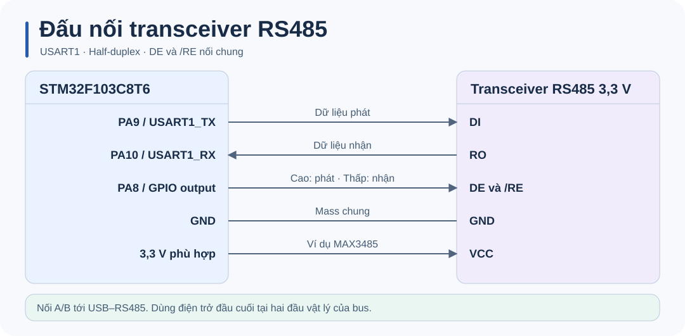
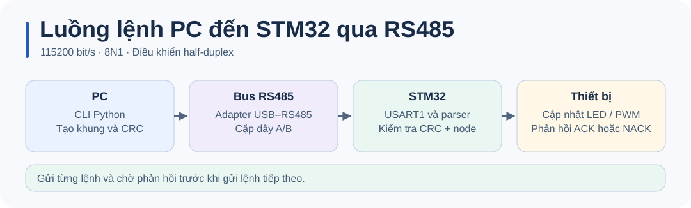

# Đấu nối RS485 với STM32

Ví dụ dùng transceiver **3,3 V** như MAX3485 và adapter USB–RS485 tự chuyển hướng. Đối chiếu nhãn chân trên module. [Datasheet MAX3485](https://www.analog.com/media/en/technical-documentation/data-sheets/MAX3483-MAX3491.pdf)

| Blue Pill | Transceiver | Ghi chú |
| --- | --- | --- |
| PA9 | DI | USART1 TX |
| PA10 | RO | USART1 RX |
| PA8 | DE và /RE | Mức cao để phát, mức thấp để nhận. |
| 3,3 V và GND | VCC và GND | Dùng transceiver tương thích nguồn và mức logic này. |
| Cặp A/B | Cặp A/B trên USB–RS485 | Kiểm tra cực tính theo tài liệu của hai adapter. |

Nối mốc GND chung cho thiết lập thử trên bàn. Với bus có hai đầu, đặt điện trở đầu cuối phù hợp với trở kháng cáp ở hai đầu vật lý, thường là 120 Ω. Dùng cặp dây xoắn A/B, nhánh rẽ ngắn và một cấu hình bias phù hợp với bus.

Nếu không có ACK, đo UART phía MCU và kiểm tra PA8 xuống thấp sau khi gửi, địa chỉ node và CRC. Kiểm tra bus ở 115200 8N1. Servo dùng [sơ đồ nguồn và PWM riêng](../README.md#phần-cứng-và-cấu-hình).
