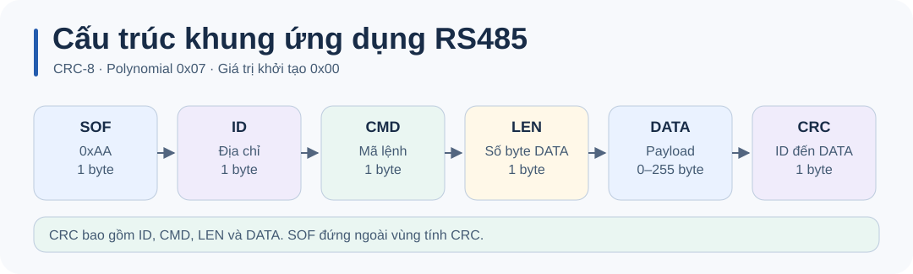

# Giao thức khung RS485

RS485 là lớp vật lý. Demo dùng giao thức riêng ở **115200 8N1**, với một lệnh đang chờ phản hồi tại mỗi thời điểm.



| Trường | Ý nghĩa |
| --- | --- |
| SOF | `0xAA`, báo bắt đầu khung. |
| ID | Địa chỉ node, mặc định `1`; `0xFF` là broadcast. |
| CMD | Mã lệnh hoặc mã phản hồi. |
| LEN | Số byte payload, 0–255. |
| DATA | Payload theo từng lệnh. |
| CRC | CRC-8 poly `0x07`, init `0x00`, không phản chiếu, không XOR cuối. Tính từ ID đến hết DATA. |

| Lệnh | CMD | Payload | Phản hồi unicast |
| --- | --- | --- | --- |
| ON / OFF / TOGGLE | `01` / `02` / `03` | Rỗng | ACK |
| SERVO_PULSE | `11` | 2 byte big-endian, 500–2500 µs | ACK hoặc NACK |
| GET_STATUS | `20` | Rỗng | ACK với 2 byte: LED 0/1 và góc quy đổi kiểu int8 |
| PING | `30` | Rỗng | ACK |
| ACK / NACK | `FE` / `FF` | Theo lệnh | Phản hồi của firmware |

Lệnh chưa hỗ trợ nhận NACK. Firmware xử lý broadcast mà không phát phản hồi để các node tránh phát cùng lúc. Khung sai CRC hoặc gửi đến ID khác bị bỏ qua. Giá trị góc trong GET_STATUS là quy đổi từ độ rộng xung, không có cảm biến đo vị trí.

Parser nhận từng byte và dùng LEN để xác định biên khung. Driver bỏ khung đang dở nếu khoảng cách giữa hai byte từ 30 ms trở lên. Xem [parser và mã hóa](../Core/Src/rs485_protocol.c) và [driver UART](../Core/Src/rs485_uart.c).

Từ thư mục gốc, có thể dùng trình biên dịch C11 cho máy tính để kiểm tra khung rỗng, CRC sai và payload 255 byte.

```sh
mkdir -p build
cc -std=c11 -ICore/Inc Core/Src/rs485_protocol.c tests/test_rs485_protocol.c -o build/test_rs485
./build/test_rs485
```
