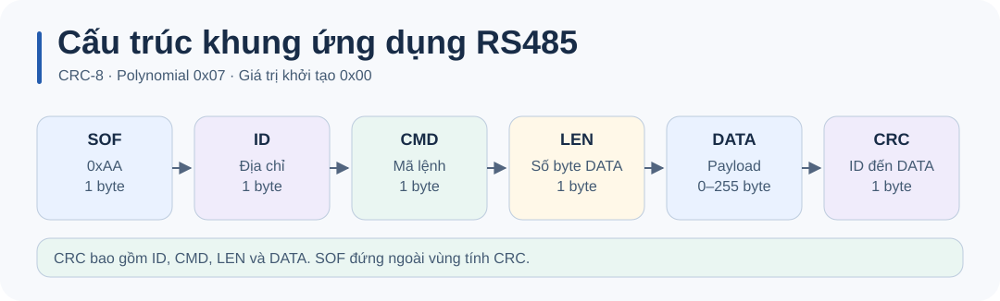

# Thử lệnh RS485 từ PC bằng Python

[`tools/rs485_cli.py`](../tools/rs485_cli.py) tạo khung, mở cổng ở 115200 8N1 và chờ ACK/NACK. Dùng `--dry-run` để xem byte hex mà không mở cổng.

```sh
python tools/rs485_cli.py on --dry-run
python tools/rs485_cli.py pulse --pulse 1500 --dry-run
```

Khi đã đấu [USB–RS485 và node](RS485_HARDWARE_SETUP.md), thay tên cổng ở các lệnh dưới đây.

```sh
python -m pip install pyserial
python tools/rs485_cli.py ping --port COM5
python tools/rs485_cli.py on --port COM5
python tools/rs485_cli.py status --node 1 --port COM5
```



Hai hàm `build_frame()` và `decode_frame()` có thể dùng lại trong script Python khác. Khi gặp timeout, kiểm tra cổng, baud rate, dây A/B và địa chỉ node. Xem [đặc tả giao thức](RS485_PROTOCOL_UART_DETAIL.md) để biết CRC và các mã lệnh.
